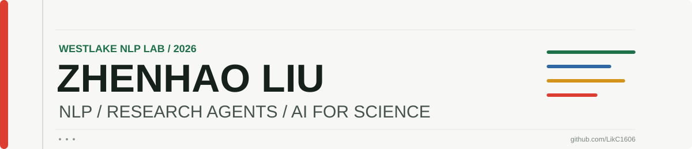

### Undergraduate researcher building evidence-grounded AI for science

[Westlake University](https://en.westlake.edu.cn/) · [Westlake NLP Lab](https://westlakenlp.com/) · [Email](mailto:liuzhenhao@westlake.edu.cn) 
Advised by Prof. [Yue Zhang](https://en.westlake.edu.cn/faculty/nlp/yue-zhang.html)

## Hello

I am **Zhenhao Liu**, an undergraduate in Artificial Intelligence at Westlake University. I work at the intersection of **natural language processing**, **research agents**, and **AI Scientist systems**.

My current interest is simple to state and difficult to solve: how can language agents turn literature, researcher insight, and experimental feedback into decisions that are useful, traceable, and scientifically defensible?

## Research

- **Evidence-grounded agents** — compiling sources and researcher priors into auditable execution policies.
- **AI for scientific discovery** — improving how agents form hypotheses, choose experiments, and learn under limited budgets.
- **Human-AI research workflows** — building tools that preserve uncertainty, negative results, and provenance.

## Honors

| Year | Competitive Programming |
| :--- | :--- |
| 2026 | Silver Medal · [ICPC Asia East Continent Final](https://cpcfinder.com/contest/77) |
| 2025 | Gold Medal · [ICPC Asia Xi'an Regional](https://cpcfinder.com/contest/66) |
| 2025 | Gold Medal · [CCPC Zhengzhou Site](https://cpcfinder.com/school/3801cd6e-5462-43ea-b737-4fcb86a35c77) |
| 2025 | Silver Medal · [ICPC Asia Shenyang Regional](https://board.xcpcio.com/icpc/50th/shenyang) |

## Find Me

I am interested in research conversations around language agents, AI for science, and evidence-grounded research workflows. Reach me at [liuzhenhao@westlake.edu.cn](mailto:liuzhenhao@westlake.edu.cn) or through [GitHub](https://github.com/LikC1606).
