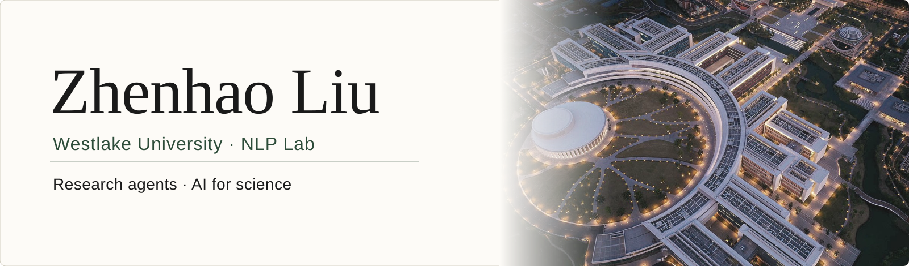

### Research agents and reproducible scientific workflows

[Westlake University](https://en.westlake.edu.cn/) · [Westlake NLP Lab](https://westlakenlp.com/) 
Advised by Prof. [Yue Zhang](https://en.westlake.edu.cn/faculty/nlp/yue-zhang.html)

[Website](https://likc1606.github.io/) · [CV](https://likc1606.github.io/assets/Zhenhao_Liu_CV.pdf) · [Email](mailto:liuzhenhao@westlake.edu.cn)

I am Zhenhao Liu, an undergraduate in Artificial Intelligence at Westlake University. My research interests include natural language processing, research agents, and the evaluation of AI systems for research.

I study how agents use literature, researcher input, and experimental feedback to guide scientific work. I also build tools that carry research practices across AI assistants and preserve the evidence behind experiments and papers.

## Selected projects

| Project | What you'll find |
| :--- | :--- |
| [Zhizhou · 知舟](https://github.com/LikC1606/zhizhou) | Portable working memory for AI coding and research, including skills, working agreements, and project context across assistants. |
| [Agent Engineering](https://github.com/LikC1606/agent-engineering) | Research workflows and tools for recording experiment commands, configurations, failures, and reruns. |
| [Agent Paper Writing](https://github.com/LikC1606/agent-paper-writing) | Paper-writing workflows with revision snapshots, LaTeX builds, and recorded visual reviews. |
| [Deep Research](https://github.com/LikC1606/deep-research-skill) | A research skill for finding and reading evidence, following new leads, and writing traceable syntheses. |
| [DeepScientist Math Proofs](https://github.com/LikC1606/deepscientist-math-proofs) | Three LeanEval V1 proof submissions with official acceptance links and original submission packages. |
| [Active Preference Acquisition](https://github.com/LikC1606/active-preference-acquisition) | A CPU-only Harbor task for active reward modeling, with offline assets and reproducible evaluation records. |

## Selected publication

[RepDuet at NLPCC 2026 Chinese BabyLM: Task-Specific Hybrid Representations for the Cognitive Track](https://likc1606.github.io/assets/RepDuet_NLPCC_2026.pdf) 
NLPCC 2026 Shared Tasks · Accepted poster · First author

Task-specific representations for word- and sentence-level fMRI encoding. 
[Paper](https://likc1606.github.io/assets/RepDuet_NLPCC_2026.pdf) · [Model and inference code](https://huggingface.co/LikC1606/chinese-babylm-cog-a197-strict-best)

## Honors

| Year | Competitive programming |
| :--- | :--- |
| 2026 | Silver Medal · [ICPC Asia East Continent Final](https://cpcfinder.com/contest/77) |
| 2025 | Gold Medal · [ICPC Asia Xi'an Regional](https://cpcfinder.com/contest/66) |
| 2025 | Gold Medal · [CCPC Zhengzhou Site](https://cpcfinder.com/school/3801cd6e-5462-43ea-b737-4fcb86a35c77) |
| 2025 | Silver Medal · [ICPC Asia Shenyang Regional](https://board.xcpcio.com/icpc/50th/shenyang) |

## Contact

For research conversations and collaboration, contact me at [liuzhenhao@westlake.edu.cn](mailto:liuzhenhao@westlake.edu.cn). More about my work is available on my [website](https://likc1606.github.io/).
